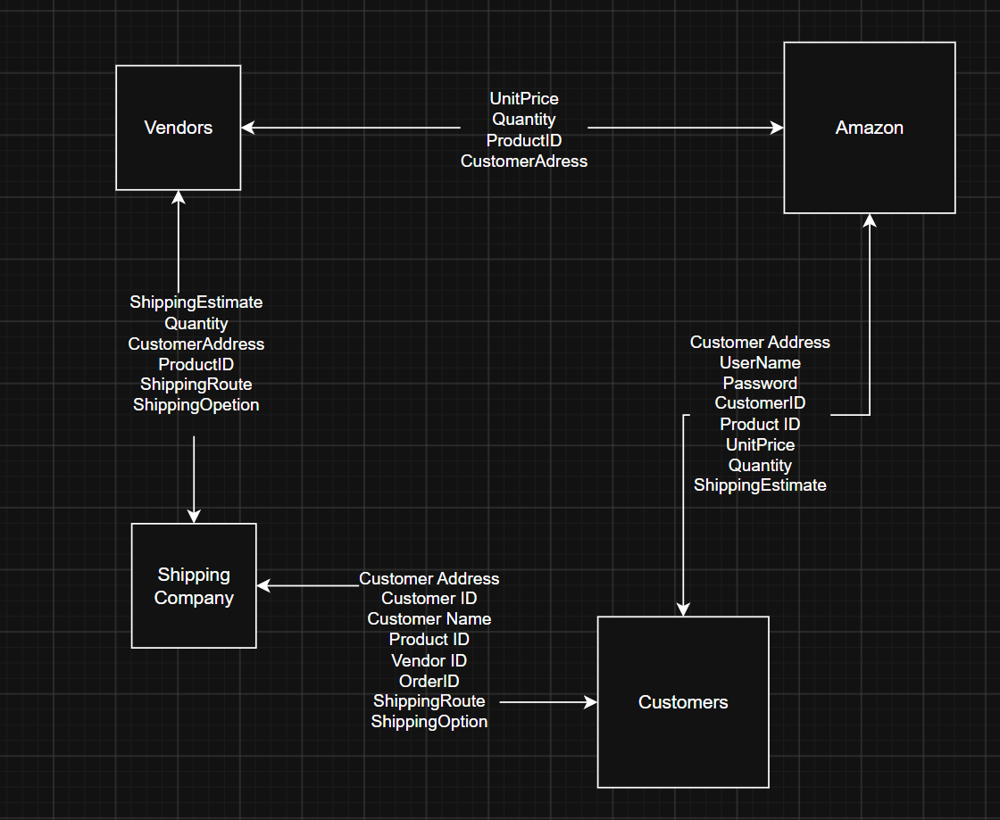

1. Create an Entity-Relationship Diagram (ERD) showing entities, attributes, and relationships.
You may:
Hand-draw the ERD and take a clear photo.
OR use a digital tool (e.g., Figma, Canva, draw.io) and take a screenshot.

2. Save the image and place it in your “Task 4” folder.

3. SQL Schema (reference Northwind Database; same database used in Geek Week)
Write CREATE TABLE statements for at least three entities, including:
Primary keys (PK)
Foreign keys (FK)
Appropriate data types and NOT NULL constraints.

Please add your SQL query below AND add an explanation: 

[Insert Code Here]

//SQL query to create a table for primary, foreign keys
CREATE TABLE

[Insert Explanation Here]
I dont remeber anything about primary and foreign keys

4. For submission, commit and push.
